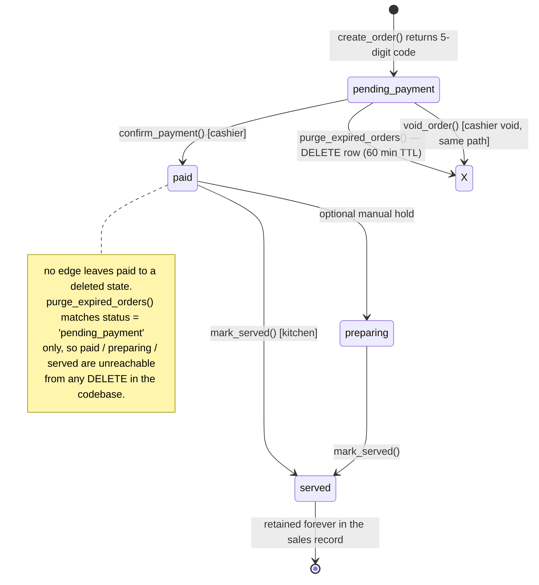

# MASTER PLAN — Sleepless Cafe 4-Role POS & Ordering System

**Status:** Plan approved for execution · **Deploy target Phase A:** GitHub Pages · **Deploy target Phase B:** Vercel (operational)
**Spec source:** `SYSTEM ARCHITECTURE & DEVELOPMENT SPECIFICATION.md` · **Governance:** `AGENTS.md` · **Design source of truth:** `Sleepless.html`

---

## 0. Executive Summary

One repository, four static HTML entry points, one Supabase project as the entire backend. No Node/Express runtime is deployed — the "backend" is Supabase (PostgreSQL + SQL functions + Storage + Realtime + RLS), and the client-side API layer must still return the SOP JSON envelope so every call site is uniform.

```
Customer ──creates──▶ orders(pending_payment) ──cashier confirms──▶ paid ──kitchen serves──▶ served
                          │                                            │
                          └── 60 min TTL ──▶ ROW DELETED               └── fulfillment_time_seconds
Owner reads everything (analytics + menu builder) ── protected by Supabase Auth + RLS
```

### The two-tier record — this is the core invariant

- **Unpaid is disposable.** An order exists only as a live claim. If the customer has not presented the code to the cashier within 60 minutes, the row is **physically deleted** from `orders`, and its `order_items` children go with it via `ON DELETE CASCADE`. There is no `expired` tombstone, no archived junk, no hidden rows. The database forgets the customer entirely.
- **Paid is permanent.** The instant the cashier confirms, the order enters the pipeline (`paid → preparing → served`) and is **never deleted and never aged out**. It is the permanent sales record that every analytics query reads. `served` is terminal-but-retained, not archived-and-removed.

So the `orders` table has exactly one meaning at all times: **live unpaid claims (≤60 min old) + the complete history of paid sales.**

Order lifecycle (the single state machine every page must agree on):



**Hard rules:**
1. State transitions happen **only** inside Supabase SQL functions. No page writes `status` directly.
2. **Only `pending_payment` rows are ever deleted.** `purge_expired_orders()` is the single DELETE path in the codebase; its predicate can never match a `paid`/`preparing`/`served` row.
3. The `status` enum is therefore only `pending_payment · paid · preparing · served`. There is **no `expired` and no `cancelled` status** — expiry and cashier-void both delete, so a status value that describes a deleted row cannot exist.

---

## 1. Governance Reconciliation (read before dispatching sub-agents)

| SOP item | Resolution for this project |
|---|---|
| `backend-lead` owns Express/Node routes | **No Node runtime.** `backend-lead` owns `sql/**` (schema, functions, RLS, Realtime config) + `assets/api.js` (the client transport that wraps Supabase and returns the JSON envelope). |
| JSON standard `{success, data, error}` | Enforced in `assets/api.js` only. Every page consumes `res.data` and branches on `res.error`. No page may `catch` and render raw text. |
| Sequential handoffs | Backend (Phase 1) must pass its verification gate before any frontend phase starts. |
| Security boundaries | Publishable key only in the browser. Service-role key never in the repo, never in a page. Owner privileges come from Supabase Auth + RLS, not from a client-side "admin flag". |
| Static hosting | GitHub Pages cannot do env vars or rewrites → separate `.html` entry points, no path routing. |
| Design reuse | `Sleepless.html` is **reference only** — palette and type are extracted into `assets/tokens.css` in Phase 0. No POS page links to it, and it links to nothing in the POS set. Its dangling `staff.html` link at `:237` is out of scope and left untouched. |

**Deliberate deviations from the spec (with rationale — flag for owner approval):**

1. **Code generation moves server-side.** Spec says the customer page generates the 5-digit code. Client-generated codes cannot be collision-checked atomically across tables. `create_order()` in SQL generates and returns the code in one insert. Customer page displays it; it never invents it.
2. **Auto-expiration is two-pronged.** GitHub Pages has no cron. `expire_due_orders()` is (a) called lazily by the cashier/kitchen list queries (cheap, self-healing), and (b) scheduled by a Supabase Cron → Edge Function in Phase B. Server-side truth either way.
3. **Tailwind CDN is Phase-A-only.** `cdn.tailwindcss.com` is a dev tool. Phase B on Vercel swaps to a compiled CSS build so production ships one cached stylesheet.
4. **`expired` and `cancelled` statuses are dropped from the spec's enum.** The spec listed both as statuses; under the owner's rule an expired order leaves no row to hold a status. Expiry is a `DELETE`, not an `UPDATE`. Consequence to be aware of: abandoned orders leave **zero trace**, so the owner cannot measure an abandonment rate and the peak-hour heatmap is a heatmap of *paid* orders, not of orders-placed. Accepted as-is; if abandonment ever matters, it needs a separate audit table, which is a Phase-B decision, not a change to this rule.

---

## 2. Repository Layout (target state)

```
Ordering System/
├── AGENTS.md                      (exists — governance)
├── SYSTEM ARCHITECTURE & DEVELOPMENT SPECIFICATION.md   (exists — spec)
├── MASTER_PLAN.md                 (this file — the build contract)
├── README.md                      (Phase 0)
├── .gitignore                     (Phase 0)
│
├── index.html                     (Phase 0 — GitHub Pages root: customer entry only)
├── menu.html                      (Phase 2 — Customer)
├── cashier.html                   (Phase 3 — Cashier)
├── kitchen.html                   (Phase 4 — Kitchen / KDS)
├── owner.html                     (Phase 5 — Owner dashboard, 4 tabs)
│
├── Sleepless.html                 (exists — DESIGN REFERENCE ONLY. Not part of the POS set,
│                                   not linked by or to any POS page, never edited.)
│
├── assets/
│   ├── tokens.css                 (brand palette extracted from Sleepless.html — single source)
│   ├── app.css                    (glass panels, scrollbars, print, KDS high-contrast theme)
│   ├── config.js                  (module: URL/keys resolution — see §4)
│   ├── api.js                     (module: JSON envelope transport + error fallbacks)
│   ├── realtime.js                (module: WS subscribe + polling fallback)
│   └── ui.js                      (module: shared tab/nav/search components)
│
├── sql/
│   ├── 01_schema.sql              (tables, FKs, CHECKs)
│   ├── 02_functions.sql           (the entire state machine)
│   ├── 03_rls.sql                 (policies)
│   ├── 04_realtime.sql            (whitelist events)
│   └── 05_seed.sql                (starter categories + menu items so dev isn't empty)
│
├── tools/
│   ├── inject-config.mjs          (Phase B: env → assets/config.generated.js)
│   └── vercel.json                (headers, cache rules)
│
└── tests/
    └── api.spec.md                (Phase 6 QA: expected JSON for every call)
```

**File-count budget per sub-agent dispatch: 1–3 files.** Never hand a specialist a multi-file refactor.

---

## 3. Phase Schedule & Task Items

| # | Phase | Owner | Deliverables | Gate to next phase |
|---|---|---|---|---|
| 0 | Repo + Pages scaffold | `devops-lead` | git init, `.gitignore`, `README.md`, `assets/tokens.css`, `index.html` launcher | Pages live at `/<repo>/`, launcher renders on phone |
| 1 | Supabase backend | `backend-lead` | `sql/01–05`, verified in Supabase Dashboard | Every function returns expected JSON/rows in the Dashboard "Run" test; seed menu visible |
| 2 | Customer page | `frontend-lead` | `menu.html`, `assets/api.js`, `assets/config.js` | Cart → checkout → real order in DB with a real 5-digit code |
| 3 | Cashier page | `frontend-lead` | `cashier.html` | Code lookup + live unpaid table + countdown + Confirm Payment flips status to `paid` |
| 4 | Kitchen KDS | `frontend-lead` | `kitchen.html`, `assets/realtime.js` | Paid order appears without refresh; Mark as Served writes `served_at` + `fulfillment_time_seconds` |
| 5 | Owner dashboard | `frontend-lead` + `backend-lead` | `owner.html`, `sql/02` analytics fns, Storage upload | Auth gate blocks anonymous; menu builder creates a real, renderable item |
| 6 | QA sweep | `qa-engineer` | `tests/api.spec.md`, lint/link checks | Zero console errors, zero dead links, envelope compliance on all 5 pages |
| 7 | Phase A deploy + dogfood | `devops-lead` | GH Pages build, mobile test, 3-order walkthrough | Full loop passes on the public URL: place → pay → serve → analytics |
| 8 | Phase B Vercel go-live | `devops-lead` | `tools/inject-config.mjs`, `vercel.json`, domain, Tailwind build | Phase A gate green + production checklist §7 all ticked |

Phases 2–5 are **strictly ordered** (customer before cashier before kitchen before owner) because each page depends on the previous page's DB side effects being real.

---

## 4. Configuration & Secrets Strategy

`assets/config.js` resolves in this priority order, so the same file works on both hosts:

1. `window.SL_CONFIG` (injected by `tools/inject-config.mjs` at Vercel build time)
2. `localStorage` override (dev convenience, `?debug=1` page)
3. Committed defaults — **publishable key only**

```js
// assets/config.js  — committed, contains no secret
export const CONFIG = {
  sbUrl:  (window.SL_CONFIG?.sbUrl)  || 'https://REPLACE_ME.supabase.co',
  sbKey:  (window.SL_CONFIG?.sbKey)  || 'sb_publishable_REPLACE_ME',
  ownerEmails: (window.SL_CONFIG?.ownerEmails || '').split(',').filter(Boolean),
  ttlMinutes: 60,
};
```

- **Phase A (GH Pages):** owner pastes URL + publishable key into `?sburl=&sbkey=` once, page writes it to `localStorage`. Nothing secret is committed.
- **Phase B (Vercel):** `SL_SB_URL`, `SL_SB_KEY`, `SL_OWNER_EMAILS` are Vercel env vars; `inject-config.mjs` runs as the build command and writes `assets/config.generated.js`. Service-role key stays **out** of the browser entirely.
### 4a. Platform facts verified live (Phases 1–3) — read before touching transport or auth

- **RPC transport:** this project's API gateway exposes SQL functions **only** under `POST /rest/v1/rpc/<fn>`. Bare `/rest/v1/<fn>` resolves against tables/views and answers `PGRST205 "Could not find the table 'public.<fn>'"` even when PostgREST's schema cache reports the RPC as loaded. `api.js` `callSql()` therefore targets `/rest/v1/rpc/…`; table reads (`getRows`) keep the bare form. Do not "fix" this by reloading the schema cache — the path form is the cause.
- **Phase-A staff account:** the free project's built-in email sender is exhausted (`over_email_send_rate_limit`), so `POST /auth/v1/signup` only succeeds with **"Confirm email" toggled OFF** on the dashboard `Authentication → Sign In / Providers` page (autoconfirm). That toggle is currently OFF. The dev staff identity is `staff-probe@sleepless-cafe.test`; `cashier.html` persists `{email,password}` in `localStorage.sl_auth` — client-side password storage is an accepted **Phase-A tradeoff**, removed in Phase B.
- **`assets/ui.js` is not created** (deviation): each page ships its own inline UI, which keeps every sub-agent dispatch inside the 1–3 file budget in §3.

**Owner auth (Phase 5):** Supabase Auth PKCE (`signInWithPassword`/magic-redirect) → id_token handed to `api.js` → RLS grants owner writes only when a valid owner session is present. `CONFIG.ownerEmails` is an allowlist check, not the security boundary — RLS is.

---

## 5. Supabase Backend Contract (`sql/02_functions.sql`)

Every function below is the single entry point for a state transition; pages call them through `api.js`.

| Function | Called by | Effect |
|---|---|---|
| `create_order(name, items jsonb) → {code, order_id, total}` | menu | Inserts `orders` + `order_items`, generates unique 5-digit code (retry loop on UNIQUE violation), sets `expires_at = NOW()+60min` |
| `get_order_by_code(code) → order + items` | cashier | Exact lookup on `pending_payment` only. `null` means "wrong code **or** expired" — deliberately indistinguishable, because an expired row no longer exists to distinguish it from |
| `list_active_pending() → rows` | cashier | Calls `purge_expired_orders()` first, then returns `status='pending_payment'` |
| `purge_expired_orders() → int` | cashier, kitchen | **`DELETE`** where `status='pending_payment' AND expires_at < NOW()`. The only DELETE path in the codebase. Returns rows removed |
| `confirm_payment(code) → order` | cashier | Atomic guard: `UPDATE ... WHERE status='pending_payment' AND expires_at >= NOW()`. 0 rows updated → "this order's time is up, please place a new one" |
| `kitchen_queue() → rows` | kitchen | `status='paid'` ordered by `paid_at` asc |
| `mark_served(id) → {fulfillment_time_seconds}` | kitchen | `paid → served`, `served_at = NOW()`, computes delta |
| `void_order(id)` | owner (Tab 1 live-claims panel — see deviation 7) | Owner-initiated delete of an unpaid order — routes through the same DELETE path as the TTL. Fenced to `pending_payment`; no cashier button exists |
| `sales_summary(from, to, grain) → metrics` | owner tab 1 | Revenue, completed count, AOV |
| `turnover_stats(from, to) → metrics` | owner tab 2 | Avg fulfillment seconds, p95, peak-hour histogram |
| `create_category / reorder_categories / delete_category` | owner tab 4 | Menu grouping control |
| `create_menu_item / update_menu_item` | owner tab 3 | Uses Storage public URL for `image_url` |

**RLS contract (`sql/03_rls.sql`)**
- `menu_items` + `categories`: public read, anonymous.
- `orders` / `order_items`: anonymous **insert** allowed (customer has no session), **update only via function**, read allowed to authenticated staff/owner.
- Menu/category writes: owner session required.
- `sql/04_realtime.sql`: whitelist **`INSERT` + `DELETE`** events on `orders`. `INSERT` feeds the cashier its new claims; **`DELETE` is what removes a row from the cashier table the instant it expires** — without it the cashier shows ghost rows for orders that no longer exist. Kitchen subscribes to `INSERT`/`UPDATE` only, since a paid order is never deleted.
- `sql/01_schema.sql` must carry `ON DELETE CASCADE` on the `order_items → orders` FK, so deleting an order cannot orphan its items. Verify this explicitly in the Phase 1 gate.
- Because paid rows are permanent, `orders` grows forever. Index `created_at`, `paid_at`, `served_at`, and `status` in `sql/01_schema.sql` so the owner's date-range queries stay cheap at 100k+ orders.

**Realtime transport (`assets/realtime.js`):** `supabase-js@2` via jsDelivr ESM in `<script type="module">`; WS subscribe on `orders`. If WS fails (network disconnect on a café tablet), fall back to 3s polling on `kitchen_queue()` — the UI must look identical either way.

---

## 6. UI Contract (all four pages inherit from `Sleepless.html`)

Reuse, do not reinvent: `brand.dark #140c08`, `brand.card #221610`, `brand.accent #d48d37`, `brand.accentLight #eec278`, `brand.cream #f8f1e5`, `brand.muted #a38f83`, `brand.border #3d271d`; Inter + Playfair Display; FontAwesome 6; glassmorphism panels; ₱ currency formatting.

**No cross-page navigation.** The four interfaces are independent sites. No POS page links to another POS page, and none links to `Sleepless.html`. Customers reach the system through `index.html` → `menu.html`; staff reach their page by direct URL/bookmark only, which keeps `cashier.html`/`kitchen.html`/`owner.html` unlisted and unguessable from the public customer page.

| Page | Layout target | Specific requirements |
|---|---|---|
| `menu.html` | Mobile-first, 390px primary | Category tabs top; picture cards (image, name, desc, size selector, ₱price, `+`/`−` stepper, Add to Cart); cart drawer with itemized totals; checkout asks Full Name; success screen shows code + name + 60-min instruction verbatim from spec |
| `cashier.html` | Desktop/tablet, `max-w-7xl` | Big code-input field (typed or scanned), instant lookup; live unpaid table columns exactly: Code · Customer Name · Time Created · Time Remaining · No. of Items/Drinks · Total Amount; Confirm Payment button. Rows **vanish** at 60 min (Realtime `DELETE` or a re-purged poll — identical result). Under 2 min remaining the row turns red and reads **LAST CALL**, since the next click may already be past the deadline |
| `kitchen.html` | KDS: high contrast, large text, tap targets ≥ 48px | Cards sorted by `paid_at`; shows name + code + paid time + **live elapsed counter**; itemized list with sizes; Mark as Served button; card leaves view |
| `owner.html` | Tabbed admin | Tab1 Sales (daily/monthly/yearly + revenue/orders/AOV + export CSV) · Tab2 Turnover (avg fulfillment, peak-hour heatmap) · Tab3 Menu builder (image upload → Storage, dynamic size/price pairs) · Tab4 Category create/reorder/delete |

Shared error UX: network down, DB timeout, invalid code, expired order, duplicate name — each gets a distinct copy string, never a stack trace.

---

## 7. Deployment Gates

### Gate A — GitHub Pages (development)
- [ ] Repo public, Pages enabled from `/` on `main`
- [ ] `index.html` is the customer entry only; no POS page links to another POS page or to `Sleepless.html`
- [ ] Staff URLs (`cashier`/`kitchen`/`owner`) unlisted — direct link/bookmark only, `noindex` on all three
- [ ] `assets/tokens.css` is the only place brand colors are defined
- [ ] Supabase project created, `sql/01–05` applied, seed menu present
- [ ] Config injected via query param → localStorage, nothing secret committed
- [ ] End-to-end dogfood on a phone: place order → cashier confirms → kitchen serves → owner analytics shows it
- [ ] TTL proven by deletion, not hiding: place an unpaid order, wait past 60 min, then `SELECT` its code in the Supabase Dashboard → **no row**, and `order_items` count for that `order_id` → **0**
- [ ] Permanence proven: a `paid` order survives 10 consecutive sweep calls and still appears in analytics
- [ ] `Sleepless.html` untouched (governance: do not refactor unrelated files)

### Gate B — Vercel (production / operational)
- [ ] Gate A fully green
- [ ] `tools/inject-config.mjs` + env vars replace the query-param hack
- [ ] Tailwind CDN replaced by compiled CSS (no dev-only CDN in prod)
- [ ] `noindex` guard removed from public customer page, retained on `owner.html`/`cashier.html`/`kitchen.html`
- [ ] Custom domain + HTTPS; `vercel.json` cache headers (HTML `max-age=0`, assets `max-age=31536000`)
- [ ] Supabase Cron → `expire_due_orders()` scheduled (server-side TTL, not client-only)
- [ ] RLS re-audited: anonymous cannot read other customers' orders or write menu changes
- [ ] Storage bucket size limit + image re-encode on upload (café menu photos are large)
- [ ] Lighthouse mobile ≥ 90 on `menu.html`; KDS readable at 2m on a wall-mounted tablet
- [ ] One full service (5+ orders) run with real staff, then freeze

---

## 8. Hardware / Context Budget (RTX 3060 12GB · 32GB RAM, local runtimes)

- One sub-agent per phase, one phase per dispatch, 1–3 files each. No "rewrite the app" prompts.
- Specialists read only the files named in their phase + `MASTER_PLAN.md` §6. They do not re-read `Sleepless.html` in full (it is ~1000 lines) — the tokens are already extracted into `assets/tokens.css` in Phase 0.
- Supabase SQL is authored as files first, pasted into the Dashboard second. No headless browser automation on this box.
- Phase 6 QA is manual-checklist driven (`tests/api.spec.md`), not a CI farm.

---

## 9. Locked Decisions (owner confirmed 2026-10-18 — no further questions before Phase 0)

1. **Code alphabet:** **digits only, randomly generated**, 5 digits (`00000–99999`). `create_order()` draws with a CSPRNG (`crypto.randombytes`-equivalent in SQL) and retries on `UNIQUE` violation. Leading zeros allowed and must be preserved — the code is `VARCHAR(5)`, never cast to integer, and the cashier input field is a string. Spoken aloud by the cashier, so no letters.
2. **Owner authentication:** Supabase Auth password login with allowlisted emails. `CONFIG.ownerEmails` is an allowlist check only — **RLS is the security boundary**.
3. **Currency:** ₱ PHP, 2 decimals, thousands separator. One formatter in `assets/api.js` (`fmtPeso`), used by all four pages.
4. **Supabase project:** new, from scratch. `sql/01–05` applied in order, and **`sql/05_seed.sql` is required** so the dev build has a menu to render before the owner builds one.
5. **No links to existing HTML.** `Sleepless.html` is palette/type reference only. The four interfaces are independent sites; `staff.html` is not created and the dangling link at `Sleepless.html:237` is left as-is (out of scope, do not edit that file).
6. **Unpaid = deleted, paid = permanent.** An order unpaid past its 60-minute TTL is `DELETE`d from `orders` (children cascade). Once `confirm_payment()` succeeds the order is permanent and is never deleted or aged out. `status` enum narrows to `pending_payment · paid · preparing · served`; `expired` and `cancelled` do not exist as states. `purge_expired_orders()` is the only DELETE in the codebase.

7. **`void_order()` is owner-only, and now wired (resolved 2026-10-19: option A).** The function table above attributes `void_order` to the cashier, but `cashier.html` deliberately ships no void control (see the comment at `cashier.html:88`): a cashier tapping void would be a one-keystroke loss of a live claim, so cashier-side removal stays the TTL's job and voiding is an owner-dashboard decision. **Resolution:** `owner.html` Tab 1 (Sales) now renders the live unpaid claims from `list_active_pending()` and offers a per-row **Void claim** button with a two-step confirm (first tap arms the row, the button re-renders as "Confirm void", second tap executes; an arm older than 12 s is dropped). `void_order` remains fenced to `pending_payment` server-side, so a paid order cannot be reached from the dashboard. `api.js` keeps the `voidOrder` export and it is now actually called.

---

## 10. Definition of Done

The system is "perfect" (the gate for Vercel) when and only when:

1. a real customer on a phone can place an order that a real cashier pays and a real kitchen serves within 60 minutes;
2. the order is invisible to every other customer;
3. the owner can see it in analytics and edit the menu that produced it;
4. an unpaid order past 60 minutes is **provably deleted** — `SELECT` on its code returns nothing in the Supabase Dashboard and its `order_items` cascade to zero, so it is absent from the cashier table, the kitchen queue, and every analytics number;
5. a paid order is **provably permanent** — it survives any number of TTL sweeps and remains in the sales record forever.

Everything else is polish.
